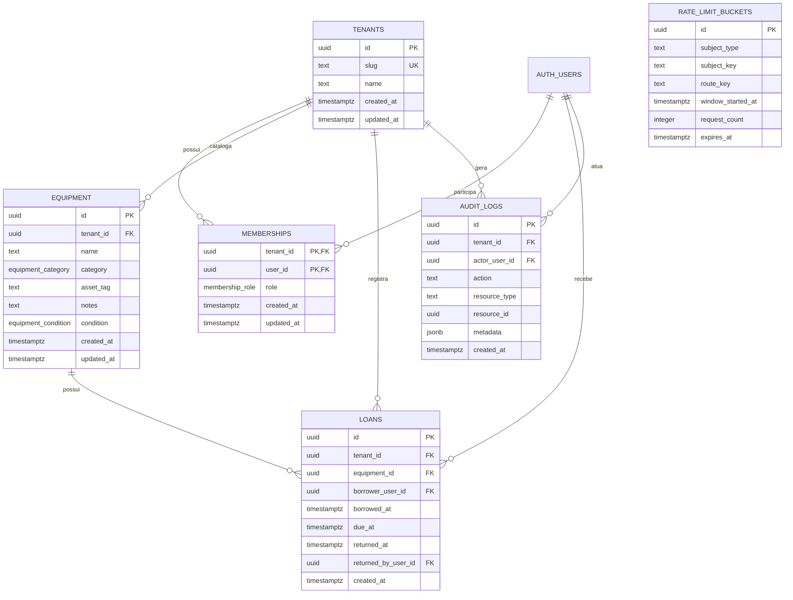

# Modelagem do banco

## 1. Escopo e decisões

Esta modelagem cobre a v1 do emprestAI e deve ser implementada no PostgreSQL do Supabase usando Prisma Migrate como único dono do schema.

Decisões:

- Banco único, multi-tenant por coluna `tenant_id`.
- Toda tabela de domínio possui `tenant_id NOT NULL`.
- Usuários são mantidos pelo Supabase Auth (`auth.users`); a API mantém apenas o vínculo por tenant em `memberships`.
- `emprestado` não é um status persistido de equipamento. É derivado da existência de um empréstimo aberto.
- `atrasado` também é derivado: empréstimo aberto com `due_at < now()`.
- RLS deve ser habilitado em todas as tabelas e suas policies devem entrar nas migrations Prisma em SQL bruto.
- Guards NestJS + CASL são a autorização primária; RLS é defesa em profundidade.
- Exclusão física de equipamentos e empréstimos não faz parte da v1. O histórico de empréstimos deve ser preservado.

Fora da v1: reservas futuras, notificações por e-mail, importação da planilha, convites modelados pela API e preferências de usuário.

## 2. Diagrama lógico

`AUTH_USERS` no diagrama representa `auth.users` do Supabase. Ela não deve ser recriada no schema Prisma da aplicação.

## 3. Tabelas

### 3.1 `tenants`

Representa uma organização ou área isolada.

| Campo | Tipo | Regras |
|---|---|---|
| `id` | `uuid` | PK, default `gen_random_uuid()` |
| `slug` | `text` | obrigatório, único, minúsculo; seed usa `suporte_ti` |
| `name` | `text` | obrigatório |
| `created_at` | `timestamptz` | obrigatório, default `now()` |
| `updated_at` | `timestamptz` | obrigatório, atualizado pela aplicação |

### 3.2 `memberships`

Vincula um usuário do Supabase a um tenant e define seu papel naquele tenant.

| Campo | Tipo | Regras |
|---|---|---|
| `tenant_id` | `uuid` | PK composta e FK para `tenants` |
| `user_id` | `uuid` | PK composta e FK para `auth.users(id)` |
| `role` | `membership_role` | `COLLABORATOR` ou `OPERATIONS` |
| `created_at` | `timestamptz` | obrigatório, default `now()` |
| `updated_at` | `timestamptz` | obrigatório |

Chave primária: `(tenant_id, user_id)`. A aplicação nunca deve aceitar `tenant_id` no body ou query; o tenant vem do contexto resolvido a partir do JWT.

### 3.3 `equipment`

Item catalogado no tenant.

| Campo | Tipo | Regras |
|---|---|---|
| `id` | `uuid` | PK, default `gen_random_uuid()` |
| `tenant_id` | `uuid` | obrigatório; FK composta com `id` lógico do tenant |
| `name` | `text` | obrigatório, não vazio |
| `category` | `equipment_category` | `NOTEBOOK`, `MONITOR`, `CABLE`, `CAMERA` ou `ACCESSORY` |
| `asset_tag` | `text` | opcional; vazio deve ser normalizado para `NULL` |
| `notes` | `text` | opcional |
| `condition` | `equipment_condition` | `AVAILABLE` ou `MAINTENANCE`; default `AVAILABLE` |
| `created_at` | `timestamptz` | obrigatório, default `now()` |
| `updated_at` | `timestamptz` | obrigatório |

`asset_tag` deve ser único quando informado dentro do mesmo tenant. A interface pode exibir `TI-—` quando o valor for nulo, mas esse texto não deve ser persistido.

A disponibilidade efetiva é:

- disponível: `condition = AVAILABLE` e não existe empréstimo aberto;
- emprestado: existe empréstimo aberto;
- em manutenção: `condition = MAINTENANCE`.

Um equipamento em manutenção não pode receber novo empréstimo. A operação de colocar em manutenção deve ser bloqueada se houver empréstimo aberto, para não criar uma situação contraditória entre catálogo e histórico.

### 3.4 `loans`

Registra cada retirada e seu ciclo de devolução. O registro permanece após a devolução.

| Campo | Tipo | Regras |
|---|---|---|
| `id` | `uuid` | PK, default `gen_random_uuid()` |
| `tenant_id` | `uuid` | obrigatório |
| `equipment_id` | `uuid` | obrigatório |
| `borrower_user_id` | `uuid` | obrigatório; usuário que está com o item |
| `borrowed_at` | `timestamptz` | obrigatório, default `now()` |
| `due_at` | `timestamptz` | obrigatório; v1 usa retirada + 14 dias |
| `returned_at` | `timestamptz` | nulo enquanto aberto |
| `returned_by_user_id` | `uuid` | nulo enquanto aberto; ator que registrou a devolução |
| `created_at` | `timestamptz` | obrigatório, default `now()` |

A devolução deve preencher `returned_at` e `returned_by_user_id` na mesma transação. A devolução feita pelo colaborador registra o próprio usuário como ator; a feita por Operações registra o usuário autenticado da operação.

Checks:

- `due_at >= borrowed_at`;
- `returned_at IS NULL OR returned_at >= borrowed_at`;
- `returned_at IS NULL` e `returned_by_user_id IS NULL`, ou ambos preenchidos.

Um empréstimo aberto é aquele com `returned_at IS NULL`.

### 3.5 `audit_logs`

Log append-only de ações relevantes. Deve registrar, no mínimo, criação/alteração de equipamento, abertura de empréstimo e devolução.

| Campo | Tipo | Regras |
|---|---|---|
| `id` | `uuid` | PK, default `gen_random_uuid()` |
| `tenant_id` | `uuid` | obrigatório |
| `actor_user_id` | `uuid` | obrigatório; FK para `auth.users(id)` |
| `action` | `text` | obrigatório e controlado pela aplicação |
| `resource_type` | `text` | obrigatório, por exemplo `equipment` ou `loan` |
| `resource_id` | `uuid` | obrigatório |
| `metadata` | `jsonb` | obrigatório, default `{}`; sem tokens, senhas ou PII desnecessária |
| `created_at` | `timestamptz` | obrigatório, default `now()` |

Não deve existir `UPDATE` ou `DELETE` para essa tabela por roles da aplicação. Retenção, anonimização e exportação LGPD ficam para decisão posterior.

### 3.6 `rate_limit_buckets`

Contador distribuído persistido no PostgreSQL, conforme ADR-001.

| Campo | Tipo | Regras |
|---|---|---|
| `id` | `uuid` | PK |
| `subject_type` | `text` | `IP` ou `USER` |
| `subject_key` | `text` | IP normalizado ou UUID do usuário |
| `route_key` | `text` | grupo de endpoint, não URL com parâmetros |
| `window_started_at` | `timestamptz` | início da janela |
| `request_count` | `integer` | obrigatório, não negativo |
| `expires_at` | `timestamptz` | fim da janela |

Chave única: `(subject_type, subject_key, route_key, window_started_at)`. Incremento e criação devem usar operação atômica (`INSERT ... ON CONFLICT DO UPDATE`). A política de limite por rota e a duração da janela devem ser definidas na configuração da API, não hard-coded no schema.

Essa tabela é técnica e não precisa de `tenant_id`: requisições anônimas são limitadas por IP. Para contadores de usuário, `subject_key` é o UUID autenticado. Ela ainda deve ter RLS habilitado e nenhuma policy de leitura para clientes finais.

## 4. Integridade e concorrência

### Índices obrigatórios

- `tenants(slug)` unique.
- `equipment(tenant_id, condition)`.
- `equipment(tenant_id, created_at DESC, id DESC)` para listagem por cursor.
- `equipment(tenant_id, asset_tag)` unique parcial quando `asset_tag IS NOT NULL`.
- `loans(tenant_id, borrower_user_id, created_at DESC, id DESC)`.
- `loans(tenant_id, due_at)` parcial para empréstimos abertos.
- `loans(tenant_id, equipment_id)` parcial unique para no máximo um empréstimo aberto por equipamento.
- `audit_logs(tenant_id, created_at DESC, id DESC)`.
- índice unique da chave de janela de `rate_limit_buckets`.

Para busca case-insensitive por nome e patrimônio, começar com `lower(...)` se a consulta for por prefixo. Se a API exigir substring, adicionar `pg_trgm` e índices GIN em migration própria após medir o padrão real.

### Abertura de empréstimo

A criação deve ocorrer em uma transação do service/repository:

1. resolver `tenant_id` e `user_id` do contexto autenticado;
2. bloquear o equipamento (`SELECT ... FOR UPDATE` ou equivalente Prisma);
3. verificar `condition = AVAILABLE`;
4. verificar que não existe empréstimo aberto para o equipamento;
5. bloquear/consultar os empréstimos abertos do usuário;
6. rejeitar se houver atraso (`due_at < now()`);
7. rejeitar se já houver 3 itens abertos;
8. criar o empréstimo com `due_at = borrowed_at + interval '14 days'`;
9. registrar auditoria;
10. confirmar a transação.

O índice unique parcial de empréstimos abertos é a última barreira contra corrida entre requests. A regra de limite de três e a regra de atraso também precisam permanecer no service dentro da mesma transação; elas não devem depender apenas do frontend.

### Devolução

A devolução deve:

1. localizar o empréstimo aberto dentro do tenant;
2. exigir que o colaborador seja o tomador ou que o ator tenha papel Operações;
3. preencher `returned_at` e `returned_by_user_id` atomicamente;
4. registrar auditoria;
5. confirmar a transação.

## 5. RLS e isolamento

Todas as tabelas devem nascer com `ENABLE ROW LEVEL SECURITY` e sem acesso implícito para roles públicas.

As policies devem usar os claims da sessão, por exemplo `auth.uid()` para o usuário e um claim de tenant definido pelo fluxo de autenticação. O nome exato do claim deve ser fechado junto com o guard JWT antes da migration final; ele não pode ser recebido do body, query ou header arbitrário.

Políticas mínimas de domínio:

- `memberships`: usuário só lê seus próprios vínculos; Operações não ganha acesso a vínculos de outro tenant apenas por role da aplicação.
- `equipment`: usuário autenticado lê somente equipamentos do tenant atual; escrita somente para Operações.
- `loans`: Colaborador lê somente seus próprios empréstimos; Operações lê os empréstimos do tenant; criação para usuário autenticado; devolução conforme autorização da API.
- `audit_logs`: sem leitura para colaboradores; leitura restrita à API/Operações conforme necessidade; sem update/delete.
- `rate_limit_buckets`: sem leitura ou escrita direta por clientes.
- `tenants`: leitura apenas do tenant presente no contexto autenticado.

Como o Prisma usa credencial de servidor que normalmente bypassa RLS, as queries da API devem sempre filtrar explicitamente `tenant_id`, e os testes de integração devem verificar isolamento por endpoint. RLS não substitui guards NestJS + CASL.

## 6. Prisma e migrations

O `schema.prisma` deve representar tabelas, relações, enums, constraints e índices que o Prisma suporta. A migration também deve conter SQL bruto para:

- extensão `pgcrypto` e, se necessário, `pg_trgm`;
- `auth.users` e referências compatíveis com Supabase;
- índices parciais (`WHERE returned_at IS NULL` e `WHERE asset_tag IS NOT NULL`);
- RLS e policies;
- triggers de `updated_at`, se escolhidos;
- proteção append-only de `audit_logs`;
- funções/triggers de integridade que não forem garantidas pelo service.

Não usar Supabase CLI como segundo dono de migrations. O fluxo oficial é `prisma migrate dev` localmente e `prisma migrate deploy` no CI antes do deploy.

## 7. Seed

`prisma/seed.ts` deve ser idempotente e criar ou atualizar somente o tenant inicial:

- `tenants.slug = 'suporte_ti'`;
- nome legível do tenant;
- nenhum usuário fictício obrigatório, pois usuários pertencem ao Supabase Auth;
- dados de equipamentos da apresentação só entram se houver uma flag explícita de seed de demonstração.

O seed não deve criar empréstimos de exemplo por padrão, pois isso altera KPIs e regras de bloqueio em ambientes de teste ou produção.

## 8. Testes obrigatórios

Com Testcontainers e PostgreSQL real:

- migration sobe do zero;
- seed pode rodar duas vezes;
- um equipamento não aceita dois empréstimos abertos;
- equipamento em manutenção não pode ser emprestado;
- devolução encerra o empréstimo e libera o item;
- usuário não passa de três empréstimos abertos;
- usuário com atraso não consegue novo empréstimo;
- dois requests concorrentes não conseguem retirar o mesmo item;
- colaborador não consulta empréstimos de outro usuário;
- tenant A não lê nem altera registros do tenant B em cada endpoint;
- auditoria é criada e não pode ser alterada/removida pela aplicação;
- rate limit incrementa atomicamente em requests concorrentes.

## 9. Pontos a fechar antes da implementação

1. Claim exato do tenant no JWT e como ele é emitido/atualizado.
2. Se patrimônio será obrigatório no futuro e qual política de alteração após cadastro.
3. Limites e janelas concretos do rate limit por rota.
4. Retenção, anonimização e exclusão de dados pessoais para LGPD.
5. Se alteração para manutenção deve ser proibida quando o item estiver emprestado ou se haverá um fluxo operacional específico.
6. Se a conta de Operações será atribuída manualmente via membership ou por convite administrativo.
